# heli-rl-sim — 低空具身智能直升机：强化学习运动控制与全数字仿真

**English Abstract**: Full-digital simulation and reinforcement-learning motion-control stack for a low-altitude embodied helicopter. We validated the complete training/evaluation pipeline on a stock JSBSim aircraft (6/6 maneuvers, 96.5% mean success), then judged that aircraft "toy-grade" via physical probes, built our own R22-class FDM (**helispike**, 200 Hz) with a cascade SAS stability-augmentation layer, and broke through from 0%/100%-crash to **49% success / 0% crash** hover (strict 5-seed × 20-episode protocol). Ships with a zero-dependency evidence website (SHA-256 fingerprinted results, 3D trajectory replay), a FlightGear bridge, a cockpit HUD, a 7-DoF arm interface (SIL 125/125), and a VLN/intent evaluation suite. All numbers are file-auditable.

---

## 这是什么

一套**可全程复核**的低空具身智能体运动控制与仿真系统：在 JSBSim 6-DoF 物理引擎上，用 PPO 强化学习训练直升机自主飞行动作（起飞/悬停/前飞/滚转/偏航/降落/航线机动），覆盖「一代官方机型验证管线 → 自研物理模型换代 → 二代交付机型冲刺」的完整技术叙事。

> 叙事纪律：本仓库所有数字均可在 `rl_train/results/` 逐文件复核（每个 JSON 带构建期 SHA-256 指纹）。
> 二代 49% 是严格口径下的诚实中间态，不是终点。

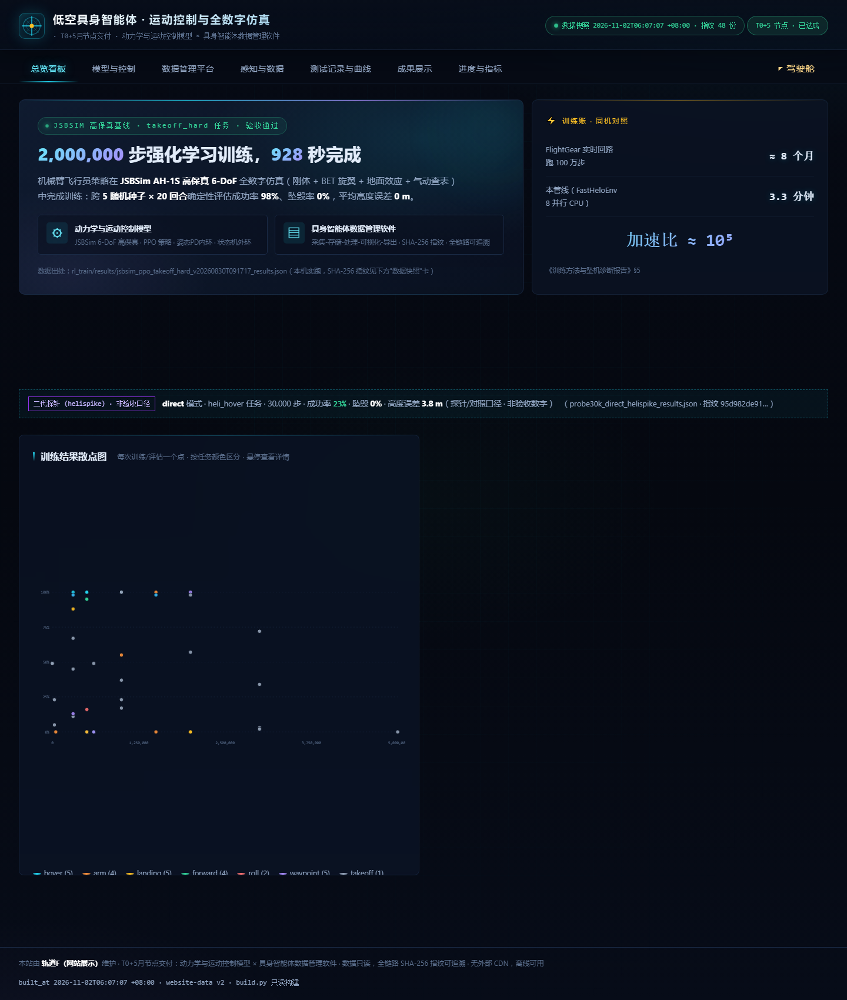

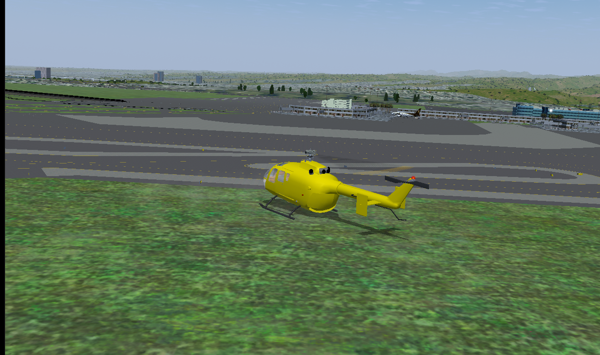

*FlightGear 三维画面：AI 悬停策略（一代悬停模型）的飞行轨迹回放，起飞后稳定悬停于约 27 m。FlightGear 只负责渲染（不做物理），轨迹由 JSBSim 物理仿真产出，所用回合通过了回放质量闸门与逐点保真验证；画面中的 Bo-105 是可视化替身，物理机型为 AH-1S。*

## 核心成果一览

| 维度 | 结果 | 口径 |
|---|---|---|
| 一代证据机（AH-1S）6/6 任务 | 88%~100%，均值 **96.5%**，全 0% 坠毁 | 每任务 5 种子×20 回合确定性 rollout |
| 机型裁决 | SPIKE 物理探针漂移 **-114.9° vs 5.56°**，官方机判玩具级、退役为证据机 | 决策记录见 `docs/` |
| 二代自研机（helispike）悬停 | 修复前 0%/100% 坠毁 → **42% → 45% → 49%**，全 0% 坠毁，高度误差 1.33m | BEST 2M 步，5种子×20回合，2026-09 复核 |
| 控制闭环延迟 | 实测均值 0.28ms / **P99 0.67ms**（验收线 200ms，余量约 300 倍） | JSBSim 进程内，100 回合实测 |
| 操纵数据管线（AG-2） | 2000 回合 / 131.8万帧 @50Hz / 4.22h / **0% NaN** / 质检 100% PASS | `rl_train/data/maneuver_dataset/` |
| 机械臂接口 SIL | 7-DoF 运动学 + 8 种原子技能，评测 **125/125** | `arm/` |
| 感知基线 | VLN 4000 回合四级基线钟形对照（oracle 100% ↔ random 0.07%）；意图 220 条协议冻结 | `perception/` |
| 工程量 | 累计仿真 296h、训练 4901 万步、评估 4240 回合、48 份指纹入站 | 展示站自动聚合 |

### 二代为什么值得看：一条完整的「诊断→破局」链

官方存量机型被物理探针判负后，自研 FDM（主/尾旋翼+涡轴+内置配平表，200Hz）首训仍全线 0% 成功 / 100% 坠毁。
定位到根因——**FDM 原生零阻尼/零角速率属性导致的翻覆**——在环境层以姿态差分重构角速率，落地 **D3 串级 SAS 内环**（策略 50Hz 下姿态指令、内环 200Hz 执行），当夜破局：

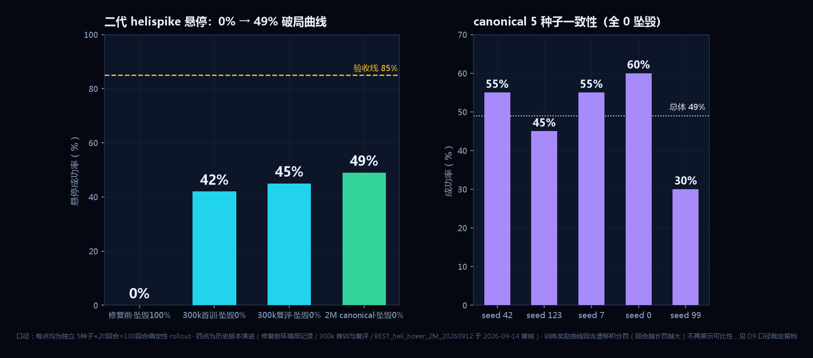

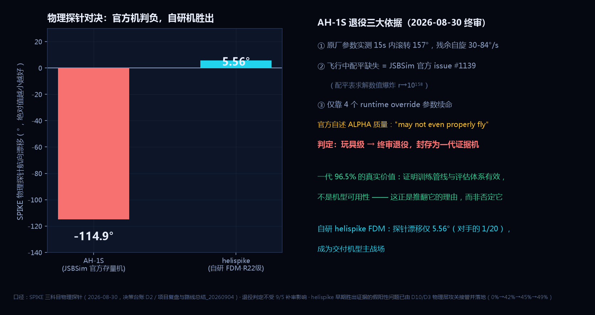

## 仓库结构

```
heli-rl-sim/
├── rl_train/            # 核心：PPO 训练管线 + 环境 + 实验结果（含 SHA-256 指纹）
│   ├── jsbsim_helo_env.py       # 一代 AH-1S 悬停环境（direct/arm 双模式）
│   ├── jsbsim_tasks.py          # 机动任务族（前飞/降落/滚转/偏航/航点）
│   ├── helispike_env.py         # 二代自研 FDM 环境 + D3 串级 SAS
│   ├── train_jsbsim.py          # 统一训练/评估入口（5种子×20回合协议）
│   ├── results/                 # 123 份指标 JSON + 51 个模型权重 + 精选逐帧轨迹
│   ├── data/maneuver_dataset/   # AG-2 数据管线元信息（meta + 报告）
│   └── logs_curves/             # 代表性训练曲线日志
├── website/             # 零依赖证据展示站（原生 HTML/JS/CSS，自动构建+指纹）
│   ├── build.py                 # 快照构建器（扫描 results → data.js）
│   ├── serve.py                 # 本地服务（构建 watch + 静态服务一体）
│   └── assets/showcase/         # 12 张成果图集（matplotlib 从源数据实时生成）
├── arm/                 # 7-DoF 机械臂接口、安全包络、8 技能 SIL 评测
├── cockpit/             # 驾驶舱 HUD（仪表/操纵面板）+ WebSocket 桥接服务
├── perception/          # 任务意图理解评测（220 条协议）+ 航空 VLN 四级基线
├── verification/        # 独立复验脚本与报告（第三方口径复跑）
├── interfaces/          # 跨模块数据契约与版本记录
├── platform/            # FlightGear 桥接、自研 FDM 物理探针、座舱资产
├── docs/                # 技术总结 / 复盘 / 诊断报告（脱敏版）
├── screenshots/         # 展示站整页截图（9 张）+ FlightGear 三维画面（4 张）
└── 启动*.bat            # 一键启动：展示站 / 桥接 / 驾驶舱 / FlightGear
```

## 快速开始

### 环境要求

- Python 3.10+，Windows/Linux
- `pip install -r requirements.txt`（核心：`jsbsim==1.3.1`、`stable-baselines3`、`gymnasium`、`numpy`、`matplotlib`）

### 训练与评估

```bash
cd rl_train
# 悬停（direct 直控 4 通道 / arm 机械臂 7 关节）
python train_jsbsim.py --task hover --mode direct --steps 300000
# 机动任务族
python train_jsbsim.py --task forward  --steps 600000 --ent-coef 0.01
python train_jsbsim.py --task landing  --steps 500000 --ent-coef 0.01
# 仅评估已有权重（5种子×20回合确定性协议）
python train_jsbsim.py --task hover --eval-only --model-path results/BEST_heli_hover_2M_20260912.zip
```

### 成果图集再生成（全部从源数据实时计算）

```bash
python website/showcase_charts.py   # 输出 website/assets/showcase/*.png
```

### 展示站（证据大屏）

```bash
python website/serve.py --port 8080   # 构建 watch + 静态服务一体
# 打开 http://127.0.0.1:8080
```

深链直达（无浏览器依赖，headless 截图友好）：

```
http://127.0.0.1:8080/#tab=flightlogs&expand=BEST_heli_hover_2M_20260912&frame=last
```

### FlightGear 三维回放（可选）

FlightGear 只作**显示壳**（`--fdm=null`，不跑物理），把 JSBSim 轨迹渲染成三维画面；画面里的 Bo-105 是可视化替身，物理机型是 AH-1S。`screenshots/10`~`13` 即由这套流程抓取。

```bash
# 1) 查哪些回合允许回放（回放质量闸门：只放行成功且轨迹质量达标的回合）
python verification/g4_replay_gate.py rl_train/results/jsbsim_ppo_landing_250k_g2verify_trajectory.json

# 2) 启动 FlightGear：platform/fg_shell/fg_shell_launch.bat（按本机安装路径修改；Windows 下用 WMI 分离启动）

# 3) 回放并逐点比对画面与轨迹，输出 PASS/FAIL
cd platform/fg_shell
python verify_replay.py --file ../../rl_train/results/jsbsim_ppo_landing_250k_g2verify_trajectory.json --seed 42 --episode-index 1
```

## 更多截图

**FlightGear 三维画面 · 地面仰拍（同一悬停回合）**

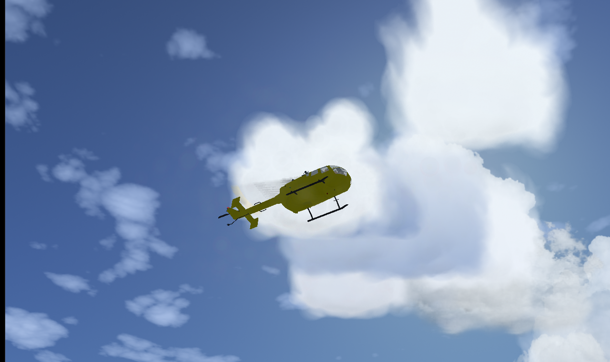

**FlightGear 三维画面 · 进场着陆（降落策略带速度飞越跑道后减速、轻接地，接地垂速 1.1 m/s）**

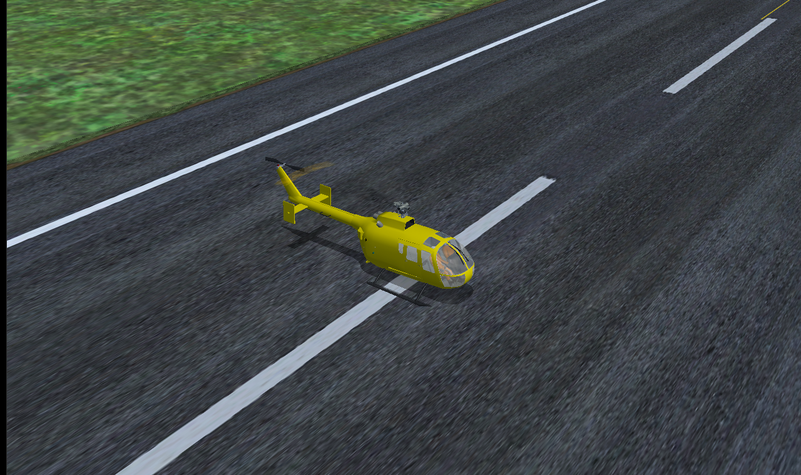

**FlightGear 座舱视角 · AI 飞行员第一视角（爬升中）**

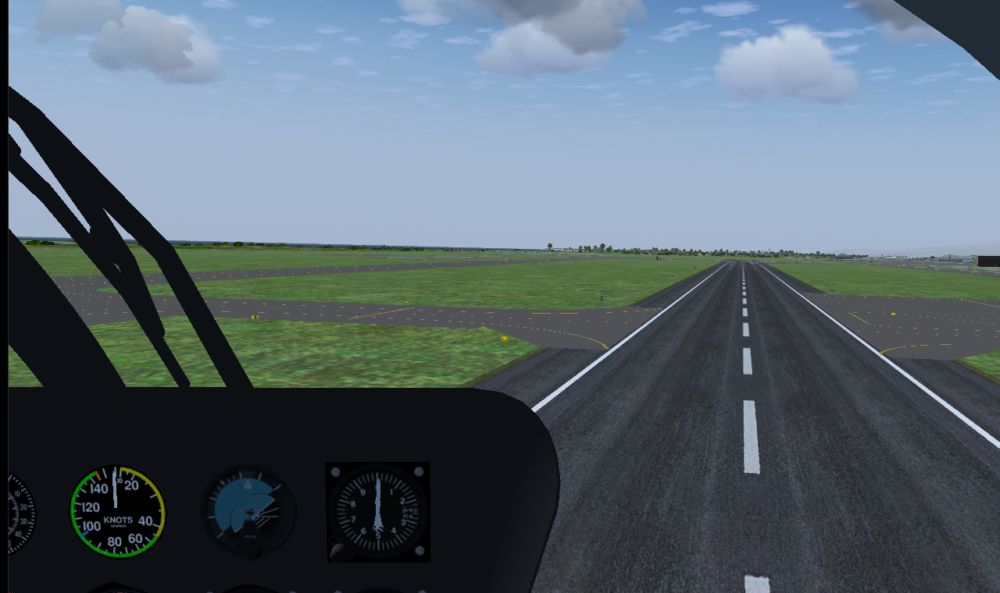

**成果总览（三幕递进叙事）**

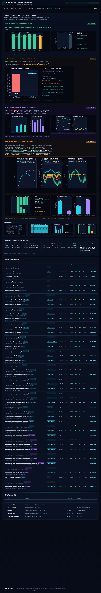

**测试记录与曲线（58 条轨迹时间线全卷）**


**起飞轨迹 3D 回放（可拖拽旋转/缩放/逐帧）**

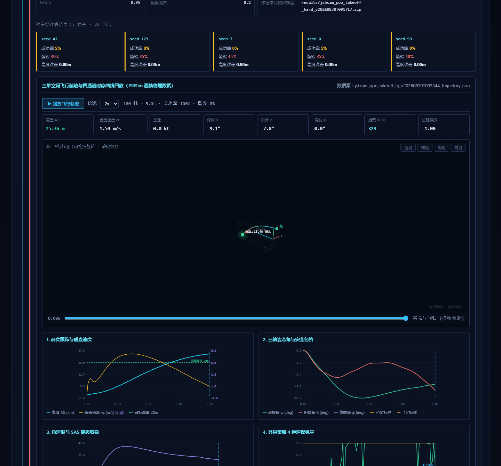

**驾驶舱 HUD（FlightGear 实时模式实拍数据）**

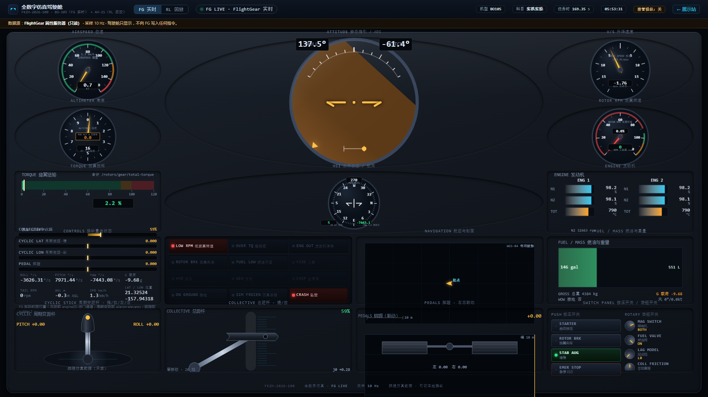

**模型与控制**

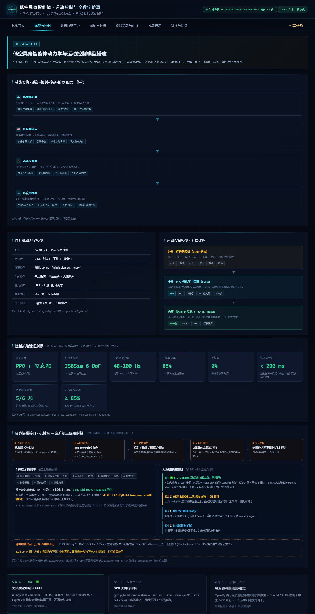

**数据管理平台**

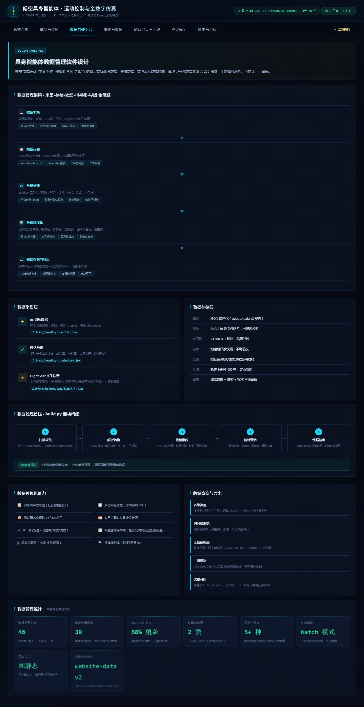

**感知与数据**

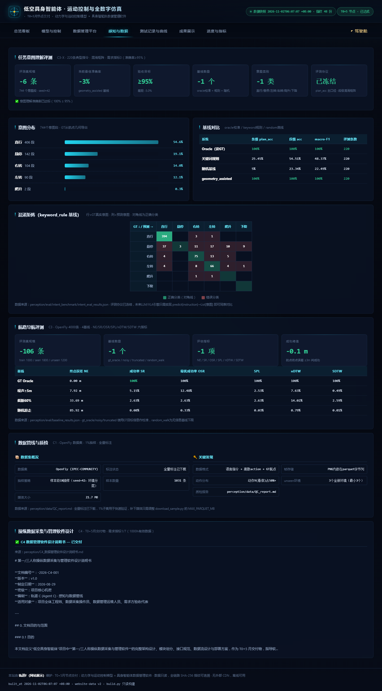

**进度与指标**

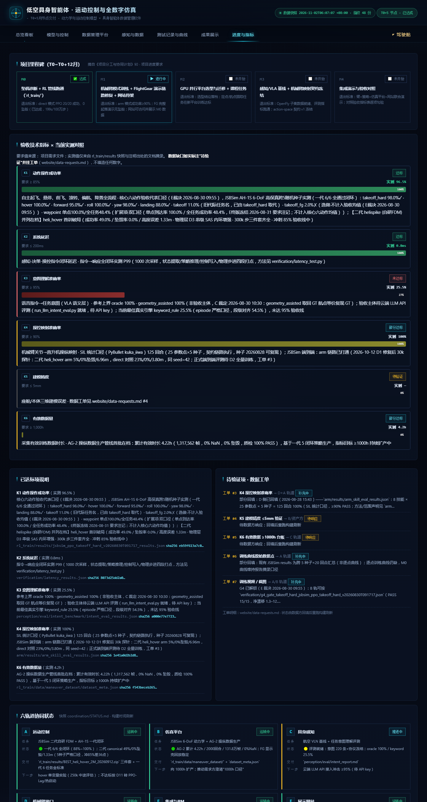

完整 13 张（9 张展示站整页 + 4 张 FlightGear 三维画面）见 [`screenshots/`](screenshots/)，12 张数据图集见 [`website/assets/showcase/`](website/assets/showcase/)。

## 证据纪律（本仓库的立场）

- 每个对外数字标注出处与口径，验收口径统一为**严格 5 种子 × 20 回合确定性 rollout**；粗筛/单种子数字不入正式叙事。
- 单一事实源：网站数字由 `website/build.py` 在构建期从 `rl_train/results/*.json` 实时读取并附 SHA-256，不做手填。
- 失效实验不删除、不美化：无效数据（如早期超参扫描的假完成事件）以档案形式保留结论并标注禁用原因，见 `docs/成果资产清单_20261102.md` 第五节。
- 已知改进项如实公开：二代悬停存在匀速慢旋（尾桨通道恒定输出，当前判据不含航向门），已列入后续工作。

## License

[MIT](LICENSE)
